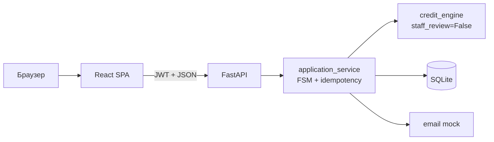

# Суирники3 — B2C-кредитный кабинет

Сервис предварительной кредитной оценки для предпринимателей. Клиент заполняет
анкету и до официальной заявки видит условия, на которые готов согласиться
банк-партнёр: сумму, срок, ставку, ежемесячный платёж и DSCR. Решение принимает
локальный credit engine по кредитной политике банка.

Продукт B2C: без банковского кабинета, ручного рассмотрения, подписания договора
и выдачи денег. В MVP один банк-партнёр и два кредитных продукта.

## Скриншоты

**Список заявок**


**Карточка заявки с оффером**


**Форма создания заявки**


## Быстрый старт

```bash
docker compose up --build
```

Приложение: http://localhost:8000

```text
client@demo.ru / password123
```

Проверка:

```bash
curl -fsS http://localhost:8000/health
curl -fsS http://localhost:8000/readyz
```

Swagger UI: http://localhost:8000/docs

## Назначение решения

Предприниматель часто подаёт заявки вслепую: сначала в один банк, потом в
другой, получает отказы и тратит время и кредитную историю. Сервис решает эту
проблему до официальной заявки:

- клиент видит ориентировочные условия банка-партнёра;
- получает объяснение отказа: текущее значение, лимит и действие;
- понимает, на каком этапе остановилось решение;
- не создаёт лишних запросов в кредитную историю в demo-режиме.

Банк получает более подготовленный поток клиентов и меньше заявок, которые
заведомо закончатся отказом.

### Границы MVP

- Один банк-партнёр, только его продукты.
- Нет сравнения банков и подбора МФО.
- Нет ручного рассмотрения заявок.
- Нет подписания договора и выдачи денег.
- Внешние проверки ЕГРЮЛ, БКИ и антифрод смоделированы.
- `risk score` — балл 0..100, а не вероятность одобрения.

## Артефакты сдачи

| Артефакт | Где | Что внутри |
|---|---|---|
| Код и история | GitHub-репозиторий | Коммиты и тег версии |
| Docker | `Dockerfile`, `docker-compose.yml` | Один контейнер: Python 3.12 + собранный frontend |
| Lock-файлы | `requirements.lock`, `Alpha-front/package-lock.json` | Точные версии зависимостей |
| README | этот файл | Запуск, архитектура, конфигурация, сценарий проверки |
| Обзор для проверяющего | [`docs/reviewer-guide.md`](docs/reviewer-guide.md), [`docs/reviewer-guide.docx`](docs/reviewer-guide.docx) | Сжатый документ для Google Docs |
| Техническое приложение | [`docs/engine-appendix.md`](docs/engine-appendix.md), [`docs/engine-appendix.docx`](docs/engine-appendix.docx) | Таблицы pipeline, факторов, примеров и ограничений |
| Синтетические данные | `app/platform/seed.py` | 4 демо-заявки и демо-аккаунт |
| Сторонние компоненты | [`THIRD_PARTY_NOTICES`](THIRD_PARTY_NOTICES) | Лицензии и смоделированные интеграции |
| Архитектура | [`docs/architecture.md`](docs/architecture.md) | Схема компонентов и режимов запуска |
| FSM заявки | [`docs/state-machine.md`](docs/state-machine.md) | Диаграмма 13 статусов и правила переходов |
| Модель данных | [`docs/data-model.md`](docs/data-model.md) | ERD на 12 таблиц |
| API | [`docs/api.md`](docs/api.md) | Endpoints, envelope, ошибки, idempotency |
| OpenAPI | [`docs/openapi.json`](docs/openapi.json), `/docs` | Машиночитаемая спецификация |
| Коллекция запросов | [`docs/api.http`](docs/api.http) | Готовые HTTP-запросы |
| Тестовые сценарии | [`docs/test-scenarios.md`](docs/test-scenarios.md) | 12 сценариев проверки |
| Демо-кейсы | [`docs/demo-cases.md`](docs/demo-cases.md) | Анна, Дмитрий, Марина, Игорь: MVP и roadmap |

## Архитектура



- **Frontend** — React + TypeScript + Vite, собранный SPA отдаётся FastAPI.
- **Backend** — FastAPI, SQLAlchemy, Pydantic v2, PyJWT.
- **Credit engine** — локальный Python-модуль, без отдельного HTTP-сервиса.
- **Хранилище** — SQLite, 12 таблиц, volume `sqlite_data` в Docker.
- **Внешние интеграции** — ЕГРЮЛ, БКИ, антифрод и email смоделированы.

Подробнее: [`docs/architecture.md`](docs/architecture.md).

## Жизненный цикл заявки

```text
DRAFT
  -> SUBMITTED
  -> INTAKE_CHECK
  -> ENRICHMENT
  -> SCORING
  -> OFFER_MADE | NEEDS_INFO | REJECTED

OFFER_MADE -> OFFER_ACCEPTED | OFFER_DECLINED | OFFER_EXPIRED
```

Дополнительно: `WITHDRAWN`, `CANCELLED`.

`SCORING` вызывает локальный `credit_engine`:

| Решение engine | Статус заявки |
|---|---|
| `APPROVED` | `OFFER_MADE` |
| `COUNTEROFFER` | `OFFER_MADE` с изменёнными условиями |
| `NEED_INFO` | `NEEDS_INFO` |
| `DECLINED` | `REJECTED` |

Engine вызывается **до** FSM-переходов. Если engine недоступен, заявка не
застревает в `SCORING`: возвращается `503 engine_unavailable`, статус остаётся
`DRAFT` или `NEEDS_INFO`.

`MANUAL_REVIEW` при `staff_review=False` не используется. Если движок всё же
вернёт его, backend отвечает `503 unsupported_ml_decision`.

### Этап решения

Каждая evaluation содержит `decision_stage`:

- `DATA` — не хватает данных;
- `PRODUCT_ELIGIBILITY` — не выполнены условия продукта;
- `RISK` — отказ по риску или платёжеспособности;
- `OFFER` — решение дошло до предложения.

Это нужно, чтобы не смешивать отказ по условиям продукта с отказом по риску.

### `NEEDS_INFO`

1. Клиент нажимает «Дополнить данные».
2. Заполняет недостающие поля.
3. Нажимает «Сохранить и подать».
4. Backend сохраняет новую revision через `PATCH`.
5. Автоматически вызывается `POST /submit`.
6. Заявка получает новый результат: `OFFER_MADE`, `REJECTED` или снова
   `NEEDS_INFO`, если данных всё ещё не хватает.

Подробнее: [`docs/state-machine.md`](docs/state-machine.md).

## Продукты и решение

| ID | Продукт | Сумма | Срок | Минимальный возраст бизнеса | Надбавка к ставке |
|---|---|---|---|---|---|
| 1 | Оборотные средства | 100 000–3 000 000 ₽ | 6–24 мес | 12 мес | +4 п.п. |
| 2 | Оборудование | 300 000–5 000 000 ₽ | 12–36 мес | 24 мес | +2 п.п. |

Ставка:

```text
annual_rate = 20% + margin продукта + 0,1 п.п. × (100 − risk_score)
```

Платёж — аннуитет. Комиссии и страховка в demo-политике равны нулю.

UI не блокирует продуктовые лимиты: он проверяет только логические границы
(сумма, срок, возраст, согласие). Engine — источник истины: он делает
counteroffer или decline и объясняет причину.

Суммы можно вводить с пробелами или без: `5 000 000` и `5000000` дают
одинаковый результат.

### Risk score

`risk score` — балл 0..100, где выше — лучше. Это не вероятность одобрения.

| Балл | Категория |
|---|---|
| 75–100 | Низкий риск |
| 50–74 | Средний риск |
| 0–49 | Высокий риск |

`calibrated_pd` всегда `null`: модель не обучена на реальных исходах. Если риск
не рассчитан, UI показывает `0 из 100` с пояснением «недостаточно данных».

## Технологический стек

| Слой | Технологии | Фиксация версий |
|---|---|---|
| Runtime в Docker | Python 3.12 (в проверенной сборке 3.12.15) | `Dockerfile` |
| Backend | FastAPI, SQLAlchemy, Pydantic v2, PyJWT | `requirements.lock` |
| Frontend | React 19, TypeScript, Vite, Tailwind CSS, shadcn/ui, axios | `Alpha-front/package-lock.json` |
| Build frontend | Node 22 | `Dockerfile` |
| База данных | SQLite | `DATABASE_URL` |
| Credit engine | локальный Python-модуль | `app/platform/ai/credit_engine.py` |
| Контейнеризация | Docker, Docker Compose | `Dockerfile`, `docker-compose.yml` |

## Структура проекта

```text
app/
  handler/              HTTP endpoints: auth, applications, health
  services/             FSM, revisions, idempotency, notifications
  platform/ai/          credit_engine.py, ml_client.py
  platform/             db.py, seed.py
  config.py             настройки из env
  models.py             SQLAlchemy-модели
  schemas.py            Pydantic-схемы и ML-контракт
  server.py             сборка FastAPI-приложения
Alpha-front/            React SPA
docs/                   архитектура, API, FSM, ERD, тест-сценарии
tests/                  19 backend-тестов
Dockerfile              multi-stage: Node 22 -> Python 3.12
docker-compose.yml      один сервис + volume SQLite
requirements.lock       точные Python-зависимости
```

## Запуск

### Требования

- Docker 24+ и Docker Compose v2.
- Для локального запуска: Python 3.12+ и Node.js 22+.
- Свободные порты `8000` (Docker) и `5173` (локальный frontend).

### Docker

```bash
docker compose up --build
```

- Приложение: http://localhost:8000
- Swagger: http://localhost:8000/docs
- Health: http://localhost:8000/health
- Readiness: http://localhost:8000/readyz

Сброс Docker-БД:

```bash
docker compose down -v
docker compose up --build
```

SQLite хранится в volume `sqlite_data`, внутри контейнера:
`/app/data/alphahack.db`.

### Локально

```bash
cp .env.example .env
make install
make dev
```

- Frontend: http://localhost:5173
- Backend: http://localhost:8000
- Swagger: http://localhost:8000/docs

Сброс локальной БД:

```bash
make reset-db
```

### Проверка

```bash
make check
```

Команда запускает:

- `pytest`;
- frontend lint;
- frontend build.

Только тесты:

```bash
make test
```

## Конфигурация

Один `.env` в корне. Backend читает его через pydantic-settings, Vite — через
`envDir`. Шаблон: `.env.example`.

| Переменная | По умолчанию | Назначение |
|---|---|---|
| `APP_ENV` | `development` | Окружение приложения |
| `HTTP_ADDR` | `:8000` | Адрес и порт backend |
| `DATABASE_URL` | `sqlite:///./alphahack.db` | Подключение к SQLite |
| `DROP_ON_START` | `false` | Пересоздать схему при старте |
| `JWT_SECRET` | `dev-insecure-change-me` | Секрет подписи JWT |
| `JWT_TTL` | `24h` | Время жизни токена |
| `ML_MODE` | `engine` | `engine`, `mock` или `http` |
| `ML_BASE_URL` | `http://localhost:8001` | URL внешнего ML-сервиса для `http` |
| `CORS_ORIGINS` | `http://localhost:5173,http://localhost:3000` | Разрешённые origins |
| `VITE_API_URL` | `http://localhost:8000` | API URL для frontend |

`JWT_SECRET` и SQLite предназначены для demo-режима. Для production нужны
нормальный секрет, миграции и внешняя БД.

## Демо-данные

```text
client@demo.ru / password123
```

Seed идемпотентный. Если engine недоступен, создаются только пользователь и
DRAFT.

| № | Статус | Запрос | Результат | Что показать |
|---|---|---|---|---|
| `#1` | `REJECTED` | 1 000 000 ₽, 24 мес | risk 25/100 HIGH | Отказ по риску и объяснение факторов |
| `#2` | `NEEDS_INFO` | 1 000 000 ₽, 24 мес | risk 0, missing fields | Дополнение данных и автоподача |
| `#3` | `OFFER_MADE` | 5 000 000 ₽, 24 мес | counteroffer 1 630 000 ₽, 23%, платёж 85 368,49 ₽, DSCR 1.300182 | Ограничение суммы |
| `#4` | `OFFER_ACCEPTED` | 1 000 000 ₽, 24 мес | 24%, платёж 52 871,10 ₽, DSCR 3.888361 | Финальный оффер |

Список сортируется по `id DESC`: `#4`, `#3`, `#2`, `#1`.

### Четыре клиентских кейса

| Клиент | Продукт | Запрос | Результат MVP | Что доказывает |
|---|---|---|---|---|
| Анна, кондитерская | Оборотные средства | 400 000 ₽ / 12 мес | `REJECTED`, risk 80/100 LOW | Отказ по возрасту бизнеса, а не по риску |
| Дмитрий, автомойки | Оборудование | 2 000 000 ₽ / 24 мес | `OFFER_MADE`, 22%, 103 756,31 ₽/мес | Сильный клиент сразу видит условия |
| Марина, стройматериалы | Оборотные средства | 1 500 000 ₽ / 24 мес | `REJECTED`, risk 55/100 MEDIUM | Долговая нагрузка и план действий |
| Игорь, грузоперевозки | Оборудование | 3 000 000 ₽ / 36 мес | `OFFER_MADE`, 22%, 114 571,36 ₽/мес | Условия до визита в банк |

Подробные шаги, ценности и roadmap: [`docs/demo-cases.md`](docs/demo-cases.md).
Все имена, компании и суммы в кейсах вымышлены.

## Пошаговый сценарий проверки

1. Запустить `docker compose up --build`.
2. Проверить `GET /health` и `GET /readyz` — оба должны вернуть `200`.
3. Войти под `client@demo.ru / password123`.
4. Открыть `#4` — `OFFER_ACCEPTED`, оффер и блок «Как принималось решение».
5. Открыть `#3` — `OFFER_MADE`, counteroffer и причина ограничения суммы.
6. Открыть `#2` — `NEEDS_INFO`; нажать «Дополнить данные», ввести выручку
   `1 500 000`, доступный поток `400 000`, долг `0`, сохранить и подать.
   Ожидается повторная оценка и `OFFER_MADE`.
7. Открыть `#1` — `REJECTED`, risk score и причины отказа.
8. Создать новую заявку: продукт, сумма `5 000 000` (можно с пробелами), срок,
   возраст, финансовые показатели, согласие. Проверить валидацию и подачу.
9. Открыть Swagger `/docs` и выполнить запросы из [`docs/api.http`](docs/api.http).
10. Запустить `make check`: 19 backend-тестов, lint и build.

## API

Все успешные ответы:

```json
{"data": {}}
```

Ошибки:

```json
{"error": {"code": "forbidden", "message": "not allowed"}}
```

Основные endpoints:

```text
POST   /api/auth/login
GET    /api/applications
POST   /api/applications
GET    /api/applications/{id}
PATCH  /api/applications/{id}
POST   /api/applications/{id}/submit
POST   /api/applications/{id}/offers/{offer_id}/accept
POST   /api/applications/{id}/offers/{offer_id}/decline
POST   /api/applications/{id}/withdraw
GET    /health
GET    /readyz
```

- Swagger UI: `/docs`
- OpenAPI JSON: [`docs/openapi.json`](docs/openapi.json)
- HTTP-коллекция: [`docs/api.http`](docs/api.http)
- Подробное описание: [`docs/api.md`](docs/api.md)

Для submit/accept/decline/withdraw frontend отправляет `Idempotency-Key`.
Повторный запрос с тем же ключом возвращает сохранённый ответ.

Основные ошибки:

- `401 unauthorized` — нет или истёк токен;
- `403 forbidden` — чужая заявка;
- `409 conflict` — недопустимый переход FSM;
- `422 invalid_application_data` — engine отклонил payload;
- `503 engine_unavailable` — engine недоступен.

## Тесты

```bash
make check
```

Текущий результат:

- **19 backend-тестов**;
- frontend lint — clean;
- frontend build — clean;
- `git diff --check` — clean.

Тесты покрывают auth, FSM, idempotency, решения credit engine, продуктовые
лимиты, `NEEDS_INFO` и повторную подачу, `decision_stage`, risk fallback и
ошибки engine.

## Ограничения MVP

1. Все внешние проверки синтетические: нет реальных ЕГРЮЛ, БКИ и антифрода.
2. Один банк-партнёр: нет сравнения банков и подбора МФО.
3. Нет ручного рассмотрения заявок.
4. Нет подписания договора и выдачи денег.
5. SQLite и demo JWT secret не предназначены для production.
6. `risk score` не является калиброванной вероятностью одобрения.
7. Офферы ориентировочные и не являются публичной офертой банка.

## Roadmap

- прогноз вероятности погашения кредита;
- прогноз погашения в срок и досрочного погашения;
- вероятность возврата клиента;
- альтернативные программы банка и партнёрские МФО;
- прогноз шансов через 3 месяца;
- обратная связь после визита в банк и рейтинг доверия к обещаниям;
- залоговый продукт со скидкой к ставке;
- multi-bank сравнение за пределами текущего MVP.

Roadmap — продуктовая концепция, а не реализованная функциональность.

## Версия

Идентификатор версии фиксируется commit hash и тегом GitHub.

```bash
git rev-parse --short HEAD
```

Тег для сдачи: `v1.0.0` (создаётся перед отправкой).
