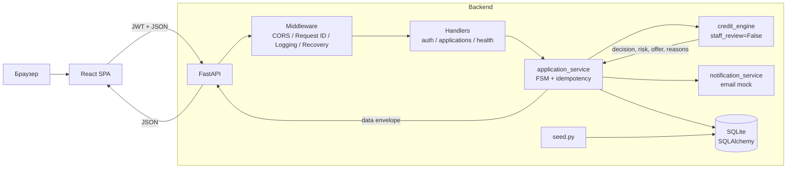

# Архитектура



## Компоненты

### Frontend

- React + TypeScript + Vite.
- AuthContext хранит JWT в `localStorage`.
- axios interceptor добавляет `Authorization`.
- `Idempotency-Key` для submit/accept/decline/withdraw.
- В Docker собранный frontend отдаётся FastAPI как static SPA.

### Backend

- `app/handler/*` — HTTP endpoints.
- `app/services/application_service.py` — FSM, доступ, revisions, idempotency.
- `app/platform/ai/credit_engine.py` — локальный движок решений.
- `app/platform/ai/ml_client.py` — adapter engine -> backend contract.
- `app/platform/seed.py` — 4 демо-заявки.
- `app/platform/db.py` — SQLAlchemy engine/session, SQLite.
- `app/services/notification_service.py` — print-мок email.

### Хранилище

- SQLite, 12 таблиц.
- В Docker: `/app/data/alphahack.db` на volume.
- Локально: `./alphahack.db`.

## Режимы

### Local dev

```text
Vite :5173 -> FastAPI :8000 -> SQLite file
```

### Docker

```text
FastAPI :8000 -> static React SPA + API -> SQLite volume
```

## Внешние интеграции

Смоделированы:

- ЕГРЮЛ / registry;
- БКИ / credit history;
- antifraud;
- email.

Реальных внешних вызовов нет.
