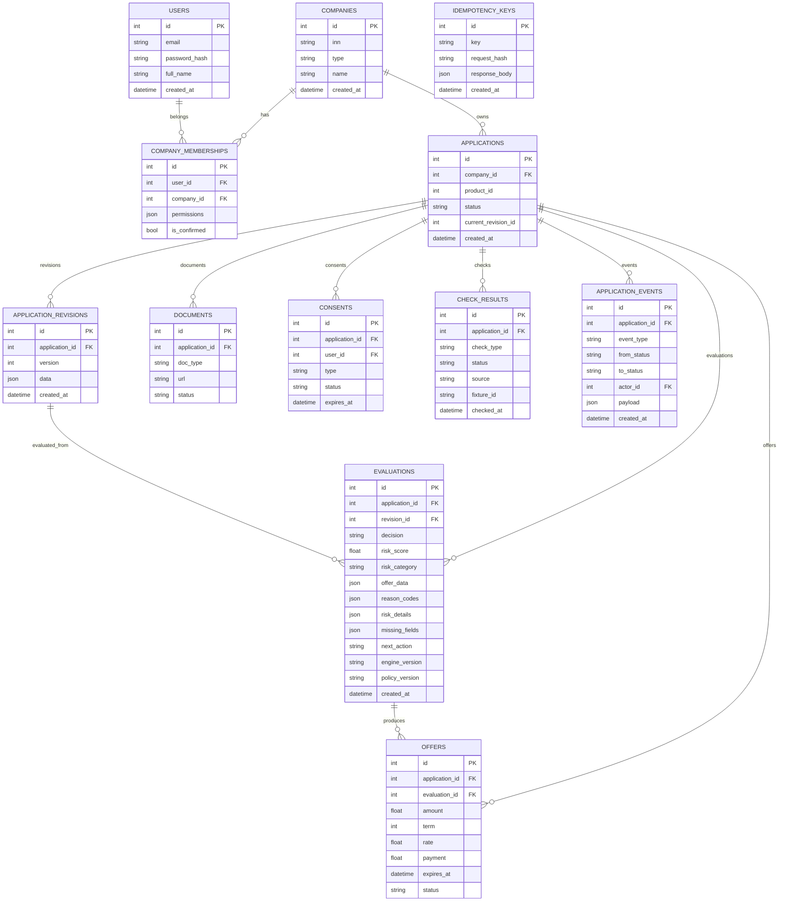

# Модель данных

SQLite, SQLAlchemy, 12 таблиц.

## Замечания

- `applications.current_revision_id` — логическая ссылка на `application_revisions.id`, не FK.
- `offers.evaluation_id` может быть `NULL`.
- `reason_codes` хранит массив объектов `{code,text,details}`.
- `risk_details` хранит `factors`, `calibrated_pd`, `next_action`.
- `idempotency_keys` не связана FK с заявкой: ключ глобальный.
