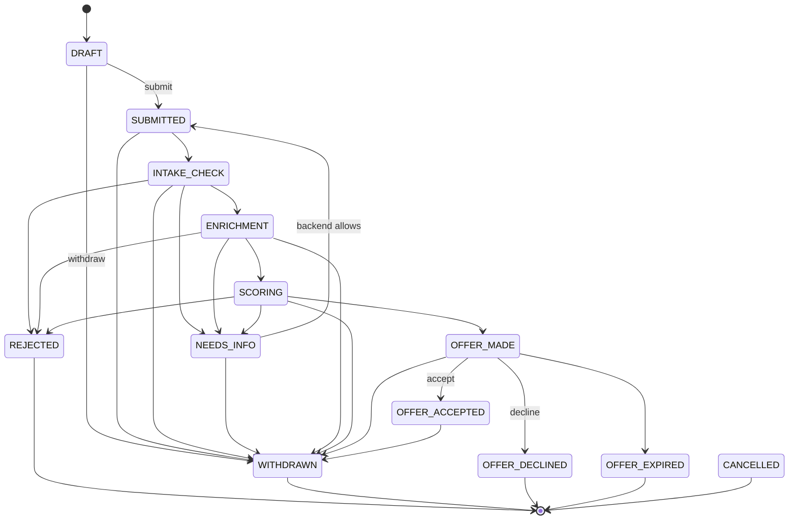

# FSM заявки



## Правила

- `OFFER_ACCEPTED` — финальный статус, кроме `WITHDRAWN`.
- `REJECTED`, `WITHDRAWN`, `OFFER_DECLINED`, `OFFER_EXPIRED`, `CANCELLED` — терминальные.
- `MANUAL_REVIEW`, `SIGNING`, `SIGNED`, `DISBURSING`, `DISBURSED` не используются.
- `NEEDS_INFO -> SUBMITTED` разрешён backend, но кнопка «Подать снова» убрана из UI.
- Каждый переход создаёт `ApplicationEvent`.
- Уведомление отправляется после commit.

## Статусы

```text
DRAFT
SUBMITTED
INTAKE_CHECK
NEEDS_INFO
ENRICHMENT
SCORING
OFFER_MADE
OFFER_ACCEPTED
REJECTED
CANCELLED
WITHDRAWN
OFFER_DECLINED
OFFER_EXPIRED
```
